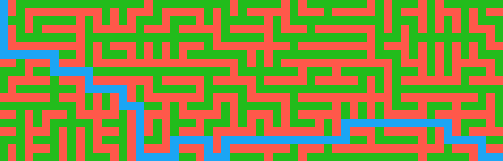
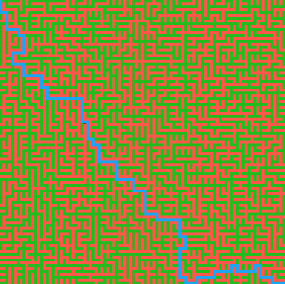
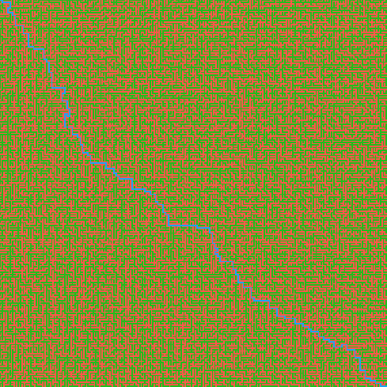

# Godot GridMap Pathfinding Prototype  
## Overview  
A free-to-reuse prototype built with Godot to procedurally generate a 2D GridMap using Prim's Algorithm and find an approximately optimal path from start to end using A* and the Manhattan Distance heuristic.



  
## Getting Started  
### Requirements  
Built with Godot .NET Engine 4.7.2 and .NET SDK 10.0 (older versions will probably be compatible with both).
### Installation  
1.Clone the repository
```bash
git clone https://github.com/Arkanioos/godot_proto_pathfinding.git
```
  
2.Import the project into Godot Engine
  
3.Run the main scene
  
## Note  
**Since this is only a prototype, the folder structure and code architecture are virtually non-existent.
Moreover, the complexity is not optimized, meaning that large grids might take a long time to load or even cause a crash.
This prototype is only about building a functional algorithm.**  

Contributions and questions are welcome!
Feel free to ask me about anything.
